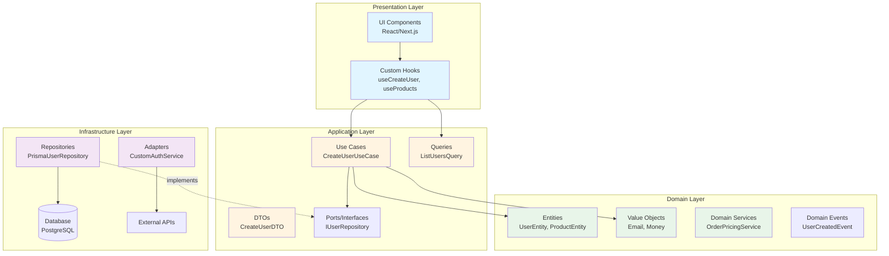
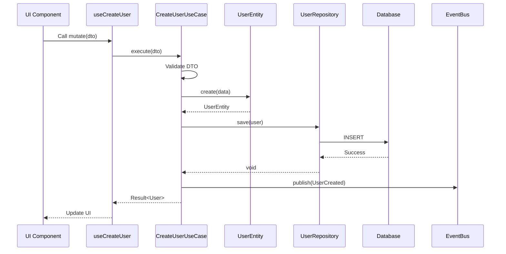
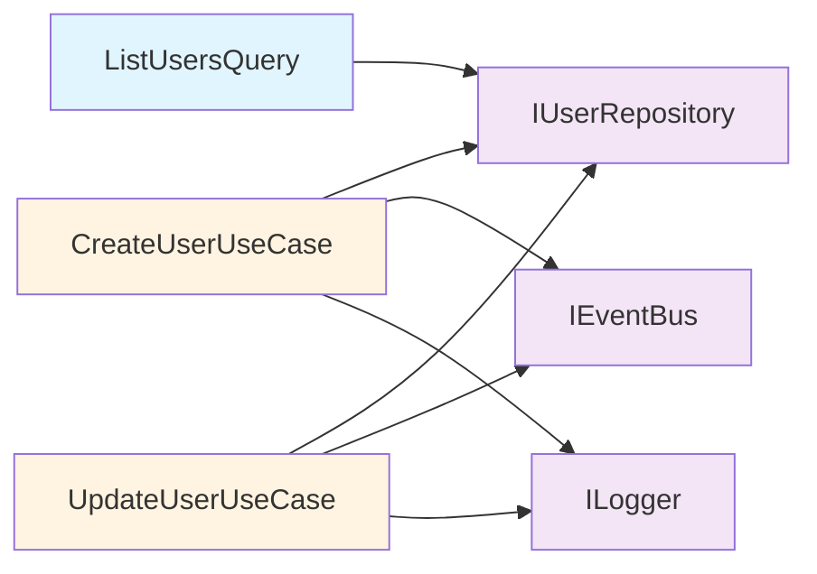
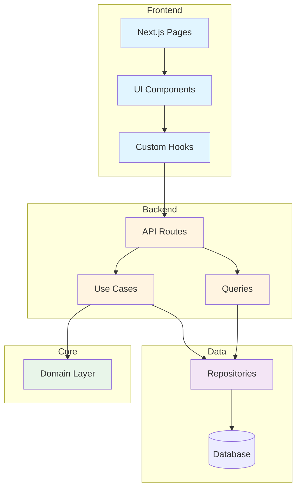

# Architecture Documentation

## Overview

This application follows **Clean Architecture** principles, ensuring separation of concerns, testability, and maintainability. The architecture is organized into four distinct layers, each with specific responsibilities and dependencies.

## Clean Architecture Layers



---

## Layer Details

### 1. Presentation Layer
**Location**: `src/presentation/`, `src/app/`, `src/components/`

**Responsibility**: User interface and user interaction

**Components**:
- **UI Components**: React components for rendering
- **Custom Hooks**: Encapsulate presentation logic
- **Pages**: Next.js pages and layouts

**Dependencies**: Application layer only (Use Cases, Queries)

**Example**:
```typescript
// presentation/hooks/use-create-user.ts
export function useCreateUser() {
  const container = getContainer();
  const createUser = container.resolve<CreateUserUseCase>('CreateUserUseCase');
  
  return useMutation({
    mutationFn: (dto: CreateUserDTO) => createUser.execute(dto)
  });
}
```

---

### 2. Application Layer
**Location**: `src/application/`

**Responsibility**: Business workflows and orchestration

**Components**:
- **Use Cases**: Command handlers (CreateUserUseCase)
- **Queries**: Read operations (ListUsersQuery)
- **DTOs**: Data transfer objects
- **Ports**: Interfaces for infrastructure

**Dependencies**: Domain layer, Infrastructure ports

**Example**:
```typescript
// application/use-cases/create-user.use-case.ts
export class CreateUserUseCase {
  async execute(dto: CreateUserDTO): Promise<Result<UserEntity>> {
    // 1. Validate input
    // 2. Apply business rules
    // 3. Create domain entity
    // 4. Persist via repository
    // 5. Publish domain event
  }
}
```

---

### 3. Domain Layer
**Location**: `src/domain/`

**Responsibility**: Core business logic and rules

**Components**:
- **Entities**: Business objects with identity
- **Value Objects**: Immutable values (Email, Money)
- **Domain Services**: Business logic that doesn't belong to entities
- **Domain Events**: Business events
- **Policies**: Business rules

**Dependencies**: None (pure business logic)

**Example**:
```typescript
// domain/entities/user.entity.ts
export class UserEntity {
  activate() { /* business logic */ }
  deactivate() { /* business logic */ }
  changeRole(role: string) { /* validation + business rules */ }
}
```

---

### 4. Infrastructure Layer
**Location**: `src/infrastructure/`

**Responsibility**: External integrations and technical details

**Components**:
- **Repositories**: Database access (Prisma)
- **Adapters**: External services (Auth, APIs)
- **Event Bus**: Event publishing
- **Logger**: Logging implementation

**Dependencies**: Application ports, Domain entities

**Example**:
```typescript
// infrastructure/database/prisma-user.repository.ts
export class PrismaUserRepository implements IUserRepository {
  async save(user: UserEntity): Promise<void> {
    await this.prisma.user.create({
      data: this.toPersistence(user)
    });
  }
}
```

---

## Data Flow Diagram



---

## Use Case Interaction Diagram



---

## Component Dependency Diagram



---

## Dependency Rules

### The Dependency Rule
**Source code dependencies must point inward**

- **Presentation** depends on **Application**
- **Application** depends on **Domain**
- **Infrastructure** depends on **Application** (via ports)
- **Domain** depends on **nothing**

### Crossing Boundaries
Communication across boundaries uses:
- **Interfaces (Ports)**: Define contracts
- **DTOs**: Transfer data
- **Dependency Injection**: Invert dependencies

---

## Key Patterns

### 1. Repository Pattern
Abstracts data access behind interfaces

```typescript
// Port (Application Layer)
export interface IUserRepository {
  save(user: UserEntity): Promise<void>;
  findById(id: string): Promise<Option<UserEntity>>;
}

// Implementation (Infrastructure Layer)
export class PrismaUserRepository implements IUserRepository {
  // Implementation details
}
```

### 2. Use Case Pattern
Encapsulates business workflows

```typescript
export class CreateUserUseCase {
  async execute(dto: CreateUserDTO): Promise<Result<UserEntity>> {
    // Single responsibility: create user
  }
}
```

### 3. Domain Events
Decouple business logic

```typescript
export class UserCreatedEvent extends BaseDomainEvent {
  constructor(public readonly userId: string) {
    super();
  }
}
```

### 4. CQRS (Command Query Responsibility Segregation)
Separate reads from writes

- **Commands**: Use Cases (CreateUserUseCase)
- **Queries**: Query handlers (ListUsersQuery)

---

## Testing Strategy

### Unit Tests
- **Domain Layer**: Test entities and value objects
- **Application Layer**: Test use cases with mocks

### Integration Tests
- **Use Cases**: Test with real repositories
- **Repositories**: Test with real database

### Component Tests
- **UI Components**: Test with React Testing Library
- **Hooks**: Test with mock use cases

### E2E Tests
- **User Flows**: Test complete workflows with Playwright

---

## Performance Monitoring

All use cases are instrumented with `PerformanceMonitor`:

```typescript
export class CreateUserUseCase {
  async execute(dto: CreateUserDTO) {
    return this.performanceMonitor.measure(
      'CreateUserUseCase',
      async () => {
        // Use case logic
      }
    );
  }
}
```

View metrics at: `/admin/metrics`

---

## Best Practices

1. **Keep Domain Pure**: No framework dependencies in domain layer
2. **Use Value Objects**: Encapsulate validation logic
3. **Fail Fast**: Validate at boundaries
4. **Immutability**: Prefer immutable data structures
5. **Single Responsibility**: One use case per business operation
6. **Dependency Injection**: Use DI container for loose coupling

---

## Further Reading

- [Clean Architecture (Robert C. Martin)](https://blog.cleancoder.com/uncle-bob/2012/08/13/the-clean-architecture.html)
- [Domain-Driven Design](https://martinfowler.com/bliki/DomainDrivenDesign.html)
- [CQRS Pattern](https://martinfowler.com/bliki/CQRS.html)
