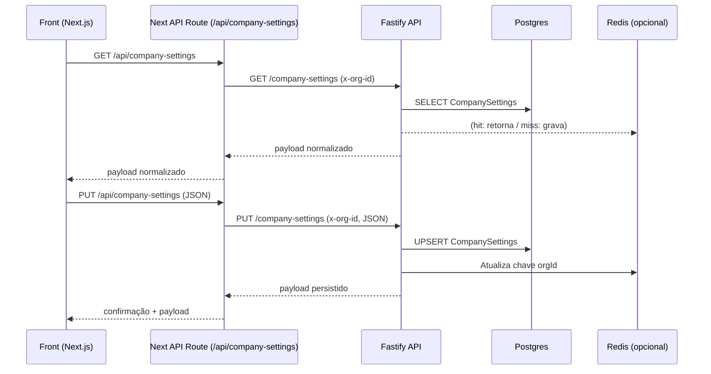

# Company Branding Module

## Visão Geral

O módulo de personalização corporativa centraliza a identidade visual do AlphaSysCore por organização. Os dados são persistidos em Postgres via Prisma e ficam disponíveis para toda a stack (API, gateway realtime e frontend).

- **Endpoint principal**: `GET/PUT /company-settings`
- **Identificador de tenant**: header obrigatório `x-org-id`
- **Persistência**: tabela `CompanySettings` (`orgId`, `logoUrl`, `primaryColor`, `secondaryColor`, `themeMode`, `videoLink`)
- **Cache opcional**: Redis (Streams não utilizados aqui), através de `CachedCompanySettingsRepository`

## Fluxo de Dados



## Estrutura da API

```typescript
// apps/api/src/modules/company-settings
registerCompanySettingsRoutes(app, repository);

// Repositórios
- PrismaCompanySettingsRepository (persistência Postgres)
- RedisCompanySettingsRepository (cache opcional)
- CachedCompanySettingsRepository (write-through)
- InMemoryCompanySettingsRepository (fallback/testes)
```

### Response

```json
{
  "logoUrl": "https://cdn.morina.ai/logo.svg",
  "primaryColor": "#2855FF",
  "secondaryColor": "#9C27B0",
  "themeMode": "auto",
  "videoLink": "https://player.vimeo.com/video/000000"
}
```

> Todas as respostas já são mescladas com `DEFAULT_COMPANY_SETTINGS`, garantindo degradê consistente mesmo sem configuração prévia.

## Frontend (Next.js)

- `useThemeEngine` faz preload do tema, aplica variáveis CSS e persiste alterações via `/api/company-settings`.
- `PersonalizationPanel` (página `settings/company`) oferece preview em tempo real, upload de logo via base64 e validação com `zod`.
- As atualizações ficam armazenadas no `localStorage` para reduzir flicker enquanto o SSR injeta os tokens.

## Operação

- **Migration**: atualizar Prisma (`pnpm --filter @morina/api exec prisma migrate dev --name company-settings`) antes de subir ambiente.
- **Variáveis**:
  - `DATABASE_URL` (obrigatório para persistência)
  - `REDIS_URL` (opcional para cache)
  - `NEXT_PUBLIC_API_URL`, `NEXT_PUBLIC_ORG_ID` no frontend
- **Monitoramento**: `/metrics` da API expõe `morina_domain_events_published_total` e `morina_domain_event_stream_length`; o módulo de settings não gera eventos próprios.

## Próximos passos sugeridos

- Versionar alterações (audit trail) reutilizando o `ProductAuditLog`.
- Oferecer staging area (preview) antes do publish.
- Enviar evento `Branding.CompanySettingsAtualizado.v1` para sincronizar com outras aplicações (mobile, TOTVS).

